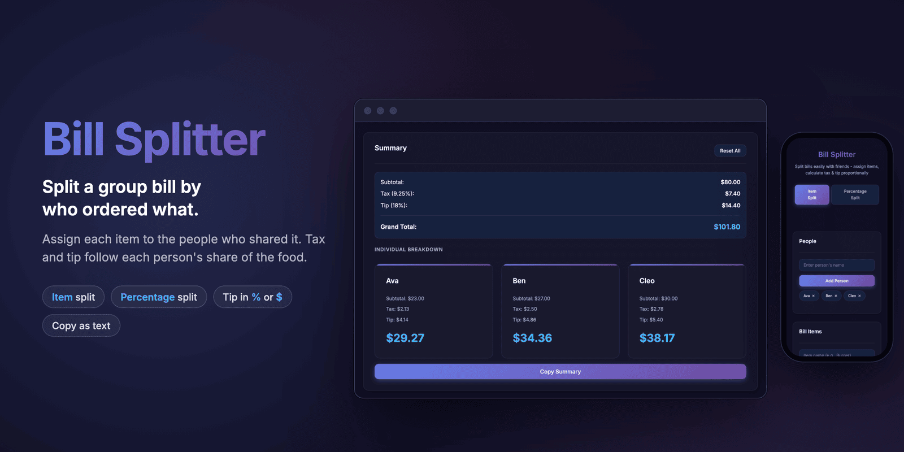
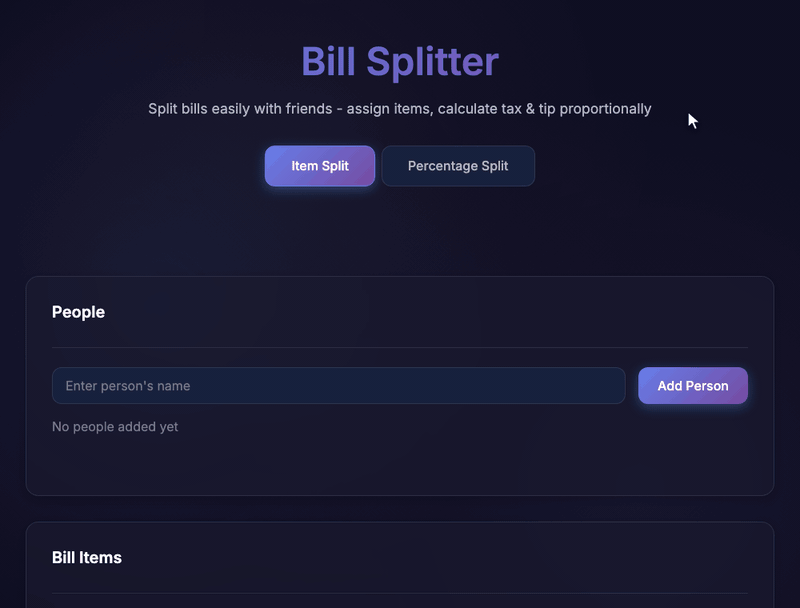
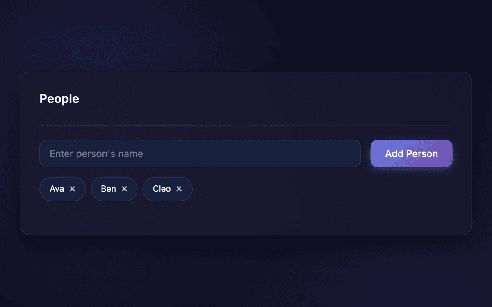
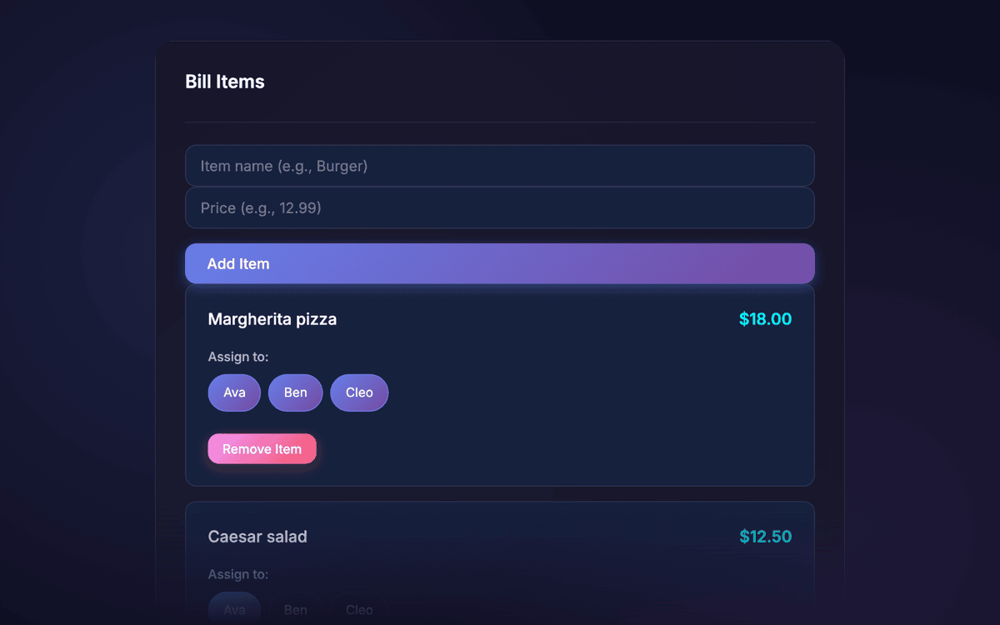
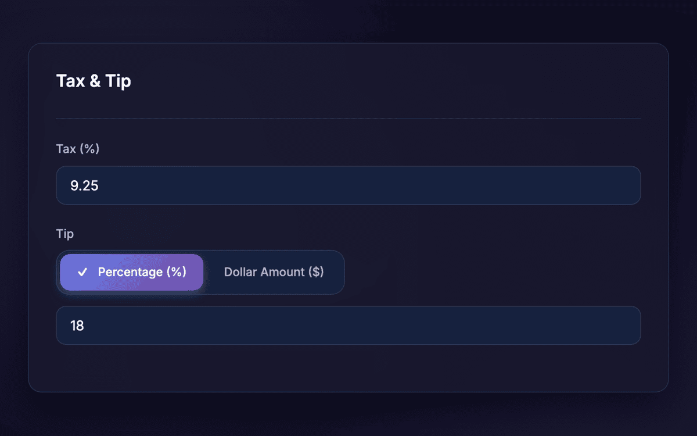
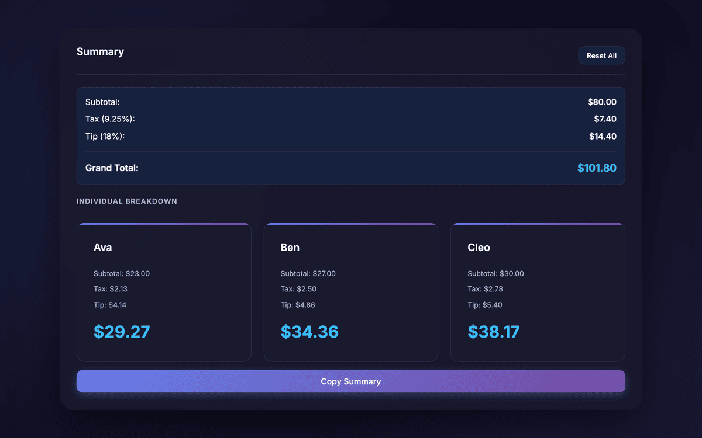
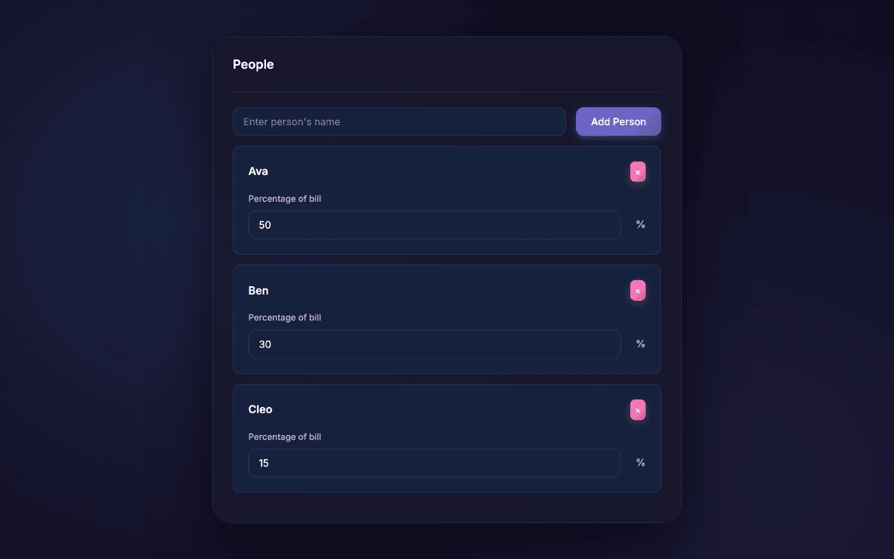
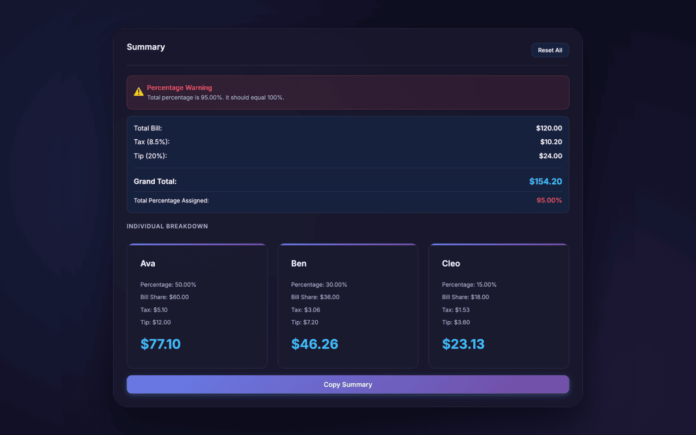

<p align="center">
  
</p>

<p align="center">
  <b>A browser calculator that splits a restaurant bill by who ordered what.</b><br>
  Add the people, tap names to assign each item, and tax and tip follow each person's share.
</p>

<p align="center">
  
  
  
  
  
</p>

<p align="center">
  <a href="#see-it-work">Demo</a> ·
  <a href="#how-it-works">How it works</a> ·
  <a href="#percentage-split">Percentage split</a> ·
  <a href="#how-the-math-works">The math</a> ·
  <a href="#run-it">Run it</a> ·
  <a href="#known-limitations">Limitations</a>
</p>

> [!NOTE]
> Archived. Bill Splitter is a small personal project from December 2025 and is no longer maintained. It has no tests, and nothing you enter is saved.

## Why

Splitting a group bill evenly is unfair when one person had a salad and another had a steak. Working out the fair split by hand means dividing shared dishes, then spreading tax and tip by each person's share. Bill Splitter does that arithmetic in the browser and gives you a text breakdown to paste into the group chat.

## See it work

<p align="center">
  
</p>

<sub>Recorded from the real page in headless Chromium, with a script typing sample names and dishes. The pointer was drawn in for the recording. Played back at about 1.5x speed.</sub>

## How it works

<table>
  <tr>
    <td width="50%"></td>
    <td width="50%"></td>
  </tr>
  <tr>
    <td valign="top"><b>1. Add who's at the table.</b> Type a name and press <kbd>Enter</kbd>. Each person becomes a chip; select <b>×</b> to remove one.</td>
    <td valign="top"><b>2. Add each item and assign it.</b> Enter a name and a price. Under <b>Assign to</b>, tap everyone who shared the dish. A shared dish is divided evenly among them.</td>
  </tr>
  <tr>
    <td width="50%"></td>
    <td width="50%"></td>
  </tr>
  <tr>
    <td valign="top"><b>3. Enter tax and tip.</b> Tax is a percentage. The tip is either a percentage of the subtotal or a fixed dollar amount, for when the tip is already on the receipt.</td>
    <td valign="top"><b>4. Read each share.</b> The summary updates as you type. <b>Copy Summary</b> copies a plain-text breakdown, and <b>Reset All</b> clears the bill after you confirm.</td>
  </tr>
</table>

### Percentage split

When everyone agrees on fixed shares, such as 50/30/20, the **Percentage Split** tab skips the items. Enter the bill total, each person's percentage, and the tax and tip percentages. Each person pays their percentage of the bill, tax, and tip.

<table>
  <tr>
    <td width="50%"></td>
    <td width="50%"></td>
  </tr>
  <tr>
    <td valign="top"><b>Enter each person's share</b> of a $120.00 bill.</td>
    <td valign="top"><b>Shares that don't add to 100% get a warning.</b> The page still shows the split, so you can see who is short.</td>
  </tr>
</table>

## How the math works

In item split mode, each person's subtotal is the sum of their dishes, with shared dishes divided evenly. Tax and tip are then spread in proportion to each subtotal. Here is Ava's total from the preceding screenshots:

| Step | Ava |
|---|---|
| A third of the $18.00 pizza, the $12.50 salad, and half the $9.00 tiramisu | $6.00 + $12.50 + $4.50 = **$23.00** |
| Her share of the $80.00 subtotal | $23.00 / $80.00 = 28.75% |
| 28.75% of the $7.40 tax | $2.13 |
| 28.75% of the $14.40 tip | $4.14 |
| **Total** | **$29.27** |

The tip percentage applies to the subtotal before tax. **Copy Summary** puts this text on the clipboard:

<details>
<summary>Copied summary for the same bill</summary>

```text
=== BILL SPLIT SUMMARY ===

Subtotal: $80.00
Tax (9.25%): $7.40
Tip (18%): $14.40
Grand Total: $101.80

--- INDIVIDUAL BREAKDOWN ---

Ava:
  Subtotal: $23.00
  Tax: $2.13
  Tip: $4.14
  Total: $29.27

Ben:
  Subtotal: $27.00
  Tax: $2.50
  Tip: $4.86
  Total: $34.36

Cleo:
  Subtotal: $30.00
  Tax: $2.78
  Tip: $5.40
  Total: $38.17
```

</details>

## Design decisions

- **Proportional tax and tip.** Whoever ordered more pays more of the tax and tip, so a small order doesn't cover part of a large one.
- **Two tip modes.** A percentage covers the usual case. A dollar amount covers receipts that already include a tip. Switching modes resets the tip to 0, so an 18% tip is never read as $18.
- **Warn, don't block.** In percentage mode, shares that don't add to 100% still produce a breakdown, with a warning on screen and in the copied text.
- **No accounts and no backend.** The calculator is static HTML, CSS, and JavaScript. The math runs in the browser, and nothing you enter leaves it.
- **Keyboard first.** <kbd>Enter</kbd> in the name field adds the person. <kbd>Enter</kbd> in the item field moves to the price, and <kbd>Enter</kbd> in the price adds the item.

## Project layout

| File | What it holds |
|---|---|
| [`index.html`](index.html), [`app.js`](app.js) | Item split page: people, items, assignments, tax and tip, summary, and copy |
| [`percentage.html`](percentage.html), [`percentage.js`](percentage.js) | Percentage split page |
| [`style.css`](style.css) | Shared dark theme, cards, chips, and tabs for both pages |
| [`server.js`](server.js), [`package.json`](package.json) | Unfinished SMS reminder server (Express and Twilio). The pages don't call it. |

## Run it

To use the calculator, serve the folder and open it in a browser. You need only Python 3, with no install or build step.

```sh
git clone https://github.com/NoelSason/BillSplitter.git
cd BillSplitter
python3 -m http.server 8000
```

Open <http://localhost:8000>. The **Item Split** and **Percentage Split** tabs switch between the two pages.

Opening `index.html` straight from disk also runs the calculator. In headless Chromium, **Copy Summary** failed from a `file://` page and worked from `localhost`, so serve the folder if you plan to copy.

### Optional: the SMS reminder server

`server.js` is an unfinished Express server for texting payment reminders through Twilio. No page calls it, and it doesn't serve the pages.

| Route | What it does |
|---|---|
| `POST /api/send-reminder` | Texts one person what they owe. Body: `name`, `phone`, `amount`, `payerName`. |
| `POST /api/send-confirmation` | Texts the payer who still owes them. Body: `name`, `phone`, `totalAmount`, `unpaidPeople`. |
| `GET /api/health` | Reports whether Twilio credentials are set. |

To run it, set `TWILIO_ACCOUNT_SID`, `TWILIO_AUTH_TOKEN`, and `TWILIO_PHONE_NUMBER` in a `.env` file, then run `npm install` and `npm start`. It listens on `PORT`, or 3000 by default. A call to either `POST` route sends a real text message and uses your Twilio balance.

## Known limitations

- **Unassigned items are dropped.** An item with nobody assigned counts toward no one's subtotal, so it's left out of the tax, tip, and grand total, with no warning.
- **Cents can drift.** Each share is rounded separately. In the demo, the shares add to $65.54 and the grand total reads $65.53.
- **Nothing is saved.** Reloading the page clears the bill.
- **US dollars only.** Amounts always show `$`. Percentage mode has no dollar-amount tip.
- **Names are inserted as raw HTML.** Names and item names aren't escaped before they're added to the page.
- **No tests.**

## Credits

Built by Noel Sason. The repository has no license file; `package.json` lists ISC.
